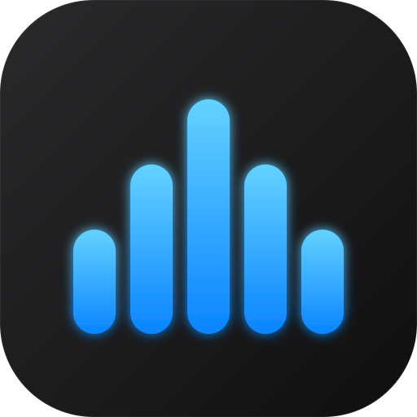

# nasTune

A self-hosted web UI for managing iPod Classic, iPod 5th generation, and Sony WALKMAN devices from a headless NAS. Runs as a Docker container; access it from any browser on your local network — no iTunes, no display required.

iPod support is built around [gpod-utils](https://github.com/d3vil-st/gpod-utils), which wraps libgpod for reading and writing the iPod's iTunesDB format. WALKMAN devices are detected via `default-capability.xml` and managed with direct file operations.

---

## Screenshots

<table>
  <tr>
    <td></td>
    <td></td>
  </tr>
  <tr>
    <td></td>
    <td></td>
  </tr>
</table>

---

## Features

- **Browse** your iPod or WALKMAN library in a 3-pane iTunes-style view (artists → albums → tracks)
- **Media types** — separate Music, Podcasts, Audiobooks, and Playlists tabs in both the device and source panes; each tab maintains its own artist/album selection and remembers the last selected source across switches
- **All Artists** — select the top row in the artist column to browse all albums across every artist in a single flat view
- **Album grid view** — a list/grid toggle in the albums column switches to a cover-art wall (two-column layout: artists | album wall); picking an album replaces the wall with its track list, and the `‹ album` heading (or clicking the tile again) goes back; the preference is remembered per browser
- **Automatic database backups** — a gzip snapshot of the iPod's iTunesDB is taken before every write operation (sync, delete, playlist edits, verify); the last 10 are kept per device and can be restored from device settings if the library ever breaks — the restore itself backs up first, so it's undoable
- **Blank iPod support** — a freshly formatted or disk-restored iPod (no iTunesDB) is detected and offered an **Initialize iPod** action that creates an empty database on the device; no iTunes needed, ever
- **Rename iPod** — set the name shown on the device itself from device settings
- **Sony WALKMAN support** — detected automatically via `default-capability.xml`; tag-based scan (mutagen) indexes the device into SQLite; delete and sync use direct file operations with immediate DB update — no rescan needed; dual-LUN models (separate INTERNAL and Card storage) are identified on USB connect by a brief read-only probe-mount of each LUN, so both appear with the correct storage type label in the device picker before any user action
- **Offline WALKMAN library** — disconnected WALKMANs appear in the Disconnected section of the device picker and can be browsed without remounting; library is served directly from SQLite
- **Force full rescan** — WALKMAN devices and NAS sources each have a full-rescan button that clears all existing library data and re-reads every file from scratch; useful after tag corrections or large file moves (confirmation dialog shown before starting)
- **Sync** tracks from a NAS music source to the device — add missing tracks, remove ones no longer in the source; sync confirmation dialog appears when deletes are involved or free space is insufficient
- **Device settings** — per-device gear icon opens a settings panel with a force-AAC override, per-media-type sync rules, and library verification tools; also available for known-but-disconnected iPods
- **Auto-sync** — one-click button in device settings runs a full sync using configured per-type source rules (music, podcasts, and audiobooks each copy with the correct media type), skipping tracks already on the device; an optional **Auto-sync on connect** toggle runs it headlessly the moment the iPod is plugged in — no browser needed. The referenced sources are rescanned first (incrementally — unchanged files are skipped), so music added to the NAS since the last scan is picked up automatically
- **Library verify** (`gpod-verify`) — mode dropdown + Run button in device settings: *Check only* (reports mismatches without changes), *Add missing entries* (creates iTunesDB entries for files on device with no DB record), *Remove orphaned entries* (deletes DB entries whose file no longer exists on device); works on connected iPods even before they are mounted — the backend mounts on demand
- **Filesystem check** (`fsck`) — device settings button unmounts the device, runs `fsck.hfsplus` or `fsck.vfat` to detect and repair filesystem errors, then remounts automatically; output shown live in the operation log modal
- **Rating sync** — iPod track ratings (1–5 stars) are persisted to SQLite on every library read; during sync, newly copied tracks automatically receive their stored ratings via `gpod-tag`; highest rating wins when the same track is seen on multiple iPods
- **Source comparison** — tracks in the iPod/WALKMAN pane appear in blue when they are absent from the selected NAS source; parent album and artist rows turn blue as soon as even a single track is missing
- **Unsynced filter** — one-click toggle in the Sources bar to show only tracks not yet on the device; state saved per browser
- **Delete** selected tracks from the device
- **Download** selected tracks as a `.tar` archive with restored directory structure (`Artist/[Year] - Album/NN - Title.ext`)
- **Star ratings** — clickable inline 1–5 star picker on every track row in both the iPod and NAS source tabs; ratings are stored in SQLite and reflected across both views; clicking the active star clears the rating
- **Playlists** — browse and edit the iPod's playlists (including On-The-Go and iTunes-created ones): add selected tracks to an existing or new playlist, remove individual tracks, delete whole playlists, sync Plex playlists to the device, and publish device playlists back to Plex; see [Playlists](#playlists)
- **Smart playlists** — iTunes-style rule editor (field / operator / value rows, match all/any, limit with selection criteria); rules are written to the iPod as real smart playlists in the iTunesDB (visible in iTunes); member lists refresh automatically after every sync; smart playlists created in iTunes can be adopted — their rules are read off the device into the editor
- **Plex integration** (optional) — link your Plex Media Server to sync playlists both ways, import star ratings and play counts from Plex, and push ratings set in nasTune back to Plex; see [Plex integration](#plex-integration)
- **Sign in with Plex** (optional) — gate the whole app behind Plex PIN OAuth (Overseerr-style); access limited to the server owner and approved users the server is shared with
- **Play** tracks directly in the browser (iPod/WALKMAN and NAS source), with ALAC→FLAC transcoding on the fly for Firefox compatibility
- **Compare** device contents against your NAS library — checkboxes show what's already synced
- **Storage bar** — shows used / net change / free with a live delete/add counter overlay during operations
- **Operation log** — click the status bar progress indicator to view live output in a terminal popup; last operation result and log persist across page reloads
- **Multi-disc album** support with CD separators and disc-aware track matching
- **Podcast metadata** — podcast sources remap show name using `albumartist → artist → album` priority (matching the iPod's grouping logic) for correct 3-column navigation (Shows → Seasons → Episodes); audiobooks navigate naturally as Authors → Books → Chapters; episodes are sorted newest-first in both the season column and episode list
- **Episode publication date** — the raw `date` tag (e.g. `2026-05-19T12:12:40`) is stored as `pub_date` and displayed as a formatted date under each episode title (e.g. "May 19, 2026"); device-side tracks show year only (gpod-ls limitation); requires a source rescan to populate
- **Unplayed indicator** — a blue dot before the episode number marks podcast episodes with zero plays; play counts are read from the iPod on every library load, persisted to `ipod_track_playcounts`, and cross-referenced in the source tab so the indicator also appears for episodes in your NAS library that are on the device but unplayed
- **Played-state sync across devices** — an episode listened to on one iPod (or marked played in Plex) is shown as played everywhere in nasTune, and the next sync marks it played on other iPods too (`gpod-tag --playcount`), clearing the on-screen unplayed bullet
- **Persistent album artwork cache** — artwork is extracted from source files and device tracks on library load, stored to disk, and served via a normalized `(artist, album)` key; works for offline iPod browsing and WALKMAN libraries where the device is not mounted
- **Device picker** — gear icon always visible on device rows; connected devices show the iPod/WALKMAN name alongside the block device name and storage type (e.g. `Serial — Internal`); unmounted iPods and WALKMANs are matched by serial/DB id so settings and library browsing are accessible even when disconnected
- **Search** with smart navigation — click an artist from results to see all their albums (when the artist name matched) or only relevant albums (when an album or track matched); clear button in the search field
- **Auto-discover** connected devices via USB polling; optional auto-mount; a freshly connected iPod or WALKMAN becomes the active device in the UI automatically (random USB sticks are never auto-selected)
- **Light / Dark / Auto** theme with system preference detection
- **Mobile-friendly** responsive 3-pane layout that collapses to a single-pane slide view on small screens
- **URL state** — navigation (tab, artist, album, device) is encoded in the hash so reloads and bookmarks work
- **Build version** displayed in the right end of the status bar (tag + short SHA + `-dirty` suffix for uncommitted local builds)

---

## Requirements

- Docker + Docker Compose
- iPod Classic (1st–6th gen), iPod 5th generation (Video), or Sony WALKMAN (NWZ/NW series with `default-capability.xml`)
- USB connection to the NAS host
- NAS music library mounted at a known path (optional, for sync)

---

## Quick start

```bash
git clone https://github.com/d3vil-st/nasTune.git
cd nasTune
docker compose up --build
```

Open `http://<nas-ip>:8080` in your browser. Connect an iPod via USB — it's detected automatically, and mounts on demand as soon as you select it (or immediately, if a per-device "Auto-sync when connected" rule is enabled).

The default `docker-compose.yml` expects:
- NAS music at `/mnt/music` on the host (read-only)

Adjust volume paths to match your setup.

---

## Configuration

All configuration is done via environment variables in `docker-compose.yml`:

| Variable | Default | Description |
|---|---|---|
| `IPOD_MOUNT_POINT` | _(unset)_ | Path to a pre-mounted iPod directory. Use this if your host mounts the iPod itself and you just want nasTune to manage it. |
| `IPOD_MOUNT_BASE` | `/mnt/ipods` | Base directory for on-demand mounts (one subdir per device). |
| `DB_PATH` | `/data/nastune.db` | SQLite database for the NAS source library index. |
| `GPOD_DRY_RUN` | `0` | Set to `1` to log all write commands without executing them. Safe for testing. |
| `NASTUNE_DISABLE_AUTH` | `0` | Set to `1` to bypass the Plex sign-in gate. Escape hatch if you lock yourself out (e.g. plex.tv unreachable or server unlinked by accident). |

---

## NAS source libraries

nasTune can index one or more directories of your NAS music collection and compare them against the iPod:

1. Click **Sources** in the header
2. Add a source by browsing to a directory (e.g. `/music`)
3. nasTune scans the directory with mutagen and indexes all audio files; rescans are incremental — files whose size and modification time are unchanged keep their index entry without re-reading tags (use **Full rescan** to force a re-read)
4. Switch back to **Library** — tracks already on the iPod are pre-checked; unchecked tracks are candidates to sync

Supported formats: MP3, FLAC, AAC/M4A (including ALAC), AIFF, WAV, OGG.

---

## Sync behaviour

- **Sync** button appears when there are changes (tracks to add or remove)
- **iTunesDB backup first**: every write operation snapshots the iPod's database to the data volume before touching it (last 10 kept per device); restore from device settings
- A confirmation dialog is shown automatically when the sync includes deletes or when the files to copy exceed available free space (accounting for space freed by deletes); the dialog shows a warning and offers "Sync anyway" for the space-insufficient case
- Tracks are matched by normalized `artist + album + track_nr` (or title if no track number), with disc number awareness for multi-disc albums
- **iPod**: when syncing a complete album or artist, the directory path is passed to `gpod-cp` rather than individual files — faster and avoids path-length issues; progress is tracked per-track from streaming output
- **Smart encoder selection**: lossless files (FLAC, WAV, AIFF, APE, WV, ALAC) are transcoded to ALAC; MP3 and AAC M4A files are copied as-is without re-encoding; other lossy formats (OGG, WMA, etc.) are transcoded to AAC via fdk-aac; the `force_aac` setting overrides this and routes everything through fdk-aac
- **iPod rating sync**: after copying tracks, nasTune runs `gpod-ls` to get fresh IDs, then applies any stored ratings to newly copied tracks via `gpod-tag`; only tracks where the stored rating is higher than the current iPod rating are updated
- **iPod played sync**: in the same step, podcast episodes that are unplayed on this iPod but have a stored play count from another device (or the Plex import) are marked played via `gpod-tag --playcount`, which also clears the iPod's on-screen unplayed bullet
- **Smart playlist refresh**: every sync ends with `gpod-playlist -U`, re-evaluating the member lists of all smart playlists on the device (nasTune- and iTunes-created)
- **WALKMAN**: sync uses `shutil.copy2` / `os.remove`; the SQLite library is updated immediately on completion without a rescan

---

## Playlists

Select **♪ Playlists** in the media type dropdown (iPod only — hidden for WALKMANs):

- **Device tab** lists the playlists on the iPod, including On-The-Go playlists created on the click wheel. Selecting one shows its tracks with inline playback. **Publish to Plex** creates (or replaces) a playlist with the same name on the linked Plex server — useful for getting On-The-Go playlists back into your library (run the Plex import first so tracks can be matched by rating key).
- **Sources tab** shows the linked Plex server's audio playlists for syncing to the device (see [Plex integration](#plex-integration)).

Any regular playlist can be edited, regardless of where it was created:

- **Remove a track** — hover a row in the playlist view and click the `×`; the track stays on the device, only the playlist entry is removed
- **Add tracks** — select tracks in the music browser and use **Add to playlist ▾** in the header to append them to an existing playlist or create a new one
- **Delete playlist** — removes the playlist itself (tracks stay on the device); built-in playlists (the master list, Podcasts) are protected by gpod-utils and cannot be deleted

Smart playlists hide the track-level editing — their membership is rule-driven — and offer the rule editor instead.

### Smart playlists

**＋ Smart** in the device playlists column opens an iTunes-style rule editor:

- Rules combine a field (title, artist, album, genre, rating, plays, skips, year, BPM, duration, size, compilation, date added, last played, …) with an operator and value; match **all** or **any** — the full gpod rule vocabulary is supported, so playlists created elsewhere round-trip without losing rules
- **Limit to** N items / minutes / hours / MB / GB, selected by random, most played, highest rating, most recently added, and more
- A live preview shows approximately how many tracks on the connected iPod match the current rules
- **Save & Apply** writes a **real smart playlist** to the iPod — the rules are stored in the iTunesDB itself (via `gpod-playlist -S`, gpod-utils ≥ 1.5.1) and are visible and editable in iTunes
- Member lists are populated on creation and refreshed automatically after every sync (the iPod firmware displays the stored member list rather than evaluating rules itself), so rules like *rating ≥ 4* or *added in the last 30 days* stay current as the library changes — this covers iTunes-created smart playlists on the device too

Definitions are stored in nasTune's database; device playlists whose name matches a stored definition show a gear icon for editing the rules. Smart playlists created in **iTunes** show the gear too — clicking it reads the rules directly off the device into the editor (adopt), so foreign smart playlists can be tweaked without iTunes. Deleting a smart playlist removes both the stored definition and the playlist from the device.

---

## Plex integration

All Plex features are optional — nasTune runs exactly as before if you never link a server.

### Linking a server

1. Open **Settings** (gear icon) → **Plex** → **Connect Plex**
2. Approve the sign-in in the Plex popup (PIN OAuth — no password ever touches nasTune)
3. Pick the server to link; nasTune probes its connections and prefers local direct access over relay

The account that links the server becomes the **admin**. Unlinking removes all Plex sessions, users, and track mappings.

The stored server address (often a `plex.direct` URL embedding your WAN IP) can go stale when your IP changes. nasTune self-heals: on a connection failure it re-resolves the server via plex.tv, picks the best reachable connection again, and retries — no re-linking needed.

### Playlists

Once linked, the **Playlists** media type's Sources tab shows your Plex audio playlists. Selecting a playlist shows its tracks matched against your NAS source libraries — first by file path (trailing-components match, so Plex and nasTune can mount the same files under different prefixes with no configuration), then by normalized artist/album/track tags as a fallback. Unmatched tracks are dimmed with a *not in library* badge. **Sync playlist** copies the matched tracks that are not yet on the device and then creates (or replaces) a playlist with the same name on the iPod via `gpod-playlist`, using the normal sync pipeline (encoder selection, progress bar, operation log).

### Ratings and play counts

- **Import** (**Import ratings** button in the Sources bar, ♪ Playlists tab — admin only) walks the whole Plex music library and merges `userRating` (converted 0–10 → 1–5 stars) and `viewCount` into nasTune's shared rating/play-count tables — highest value wins, so re-importing is safe. Imported ratings flow to the iPod on the next sync via `gpod-tag`.
- **Push-back**: rating a track in the nasTune UI (device or source pane) updates Plex within seconds. Clearing a rating clears it in Plex too.

### Sign in with Plex

Settings → Plex → **Require Plex sign-in** gates the entire app behind Plex login:

- Only the admin and users your Plex server is shared with (friends / Plex Home) can authenticate
- New users land as **pending** and must be approved by the admin in the Settings users list; disabling a user revokes their sessions immediately
- Non-admin users get full app access except settings and Plex management
- Sessions last 30 days (HttpOnly cookie); plex.tv is only contacted at login, so an internet outage doesn't lock out existing sessions
- Locked out anyway? Start the container with `NASTUNE_DISABLE_AUTH=1`

---

## Download

Select tracks on the iPod and click **Download** to receive a `.tar` archive. The iPod stores files with obfuscated names (`:iPod_Control:Music:F02:TGWN.mp3`); nasTune restores the original structure:

```
Artist/
  [2024] - Album Name/
    01 - Track Title.mp3
    02 - Another Track.mp3
```

The archive is streamed directly from the iPod to your browser — no temporary files are written on the server.

---

## Architecture

| Layer | Technology |
|---|---|
| Backend | FastAPI + Uvicorn (Python 3.12) |
| Frontend | Alpine.js 3.15 (vendored) + Jinja2 templates + plain CSS |
| iPod I/O | gpod-utils CLI (libgpod wrapper) |
| WALKMAN I/O | shutil file operations + SQLite library cache |
| Tag reading | mutagen |
| Audio transcode | ffmpeg (ALAC→FLAC, streaming + seekable tmpfs cache) |
| Library index | SQLite + aiosqlite |
| Device discovery | lsblk polling every 3 s |
| Plex API | httpx (PIN OAuth via plex.tv, playlists/ratings via server API) |

No Node.js. No build step. No bundler.

---

## Development

```bash
python3 -m venv .venv
source .venv/bin/activate
pip install -r requirements.txt

IPOD_MOUNT_POINT=/mnt/ipod uvicorn app.main:app --reload --port 8080
```

`gpod-ls` and `ffmpeg` must be on `PATH`. Without a connected iPod the app starts normally with an empty device list — the source library scanner works independently.

See [CLAUDE.md](CLAUDE.md) for full architecture documentation, API reference, and known constraints.

---

## Reverse proxy

nasTune works behind a reverse proxy (nginx, Caddy, Traefik) and is compatible with Authentik forward authentication.

Three endpoint groups need special treatment because they use long-lived SSE streams or large audio responses:

```nginx
location ~ ^/(devices/events|operations/events|audio|sources/audio) {
    proxy_pass http://nastune_backend;
    proxy_http_version 1.1;
    proxy_set_header Connection '';
    proxy_buffering off;
    proxy_cache off;
    proxy_read_timeout 3600s;
    gzip off;
}
```

- **`proxy_http_version 1.1`** — nginx defaults to HTTP/1.0 upstream; SSE requires 1.1 for chunked transfer or events arrive batched at connection close.
- **`proxy_set_header Connection ''`** — clears the `Connection: close` header that HTTP/1.0 adds.
- **`proxy_buffering off` + `gzip off`** — prevents nginx from buffering SSE output waiting to fill a buffer or compress it, which kills real-time delivery.
- **`proxy_read_timeout 3600s`** — SSE connections are idle between events; the default 60 s timeout would close them.

If your global config includes an Authentik `include` directive, add it to this location block too so the streaming endpoints remain protected.

---

## License

MIT
